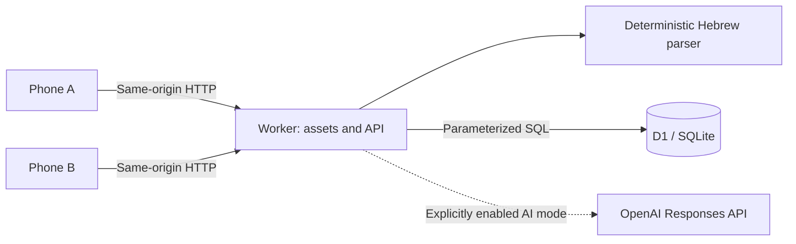

# Agala — Shared Shopping List

A Hebrew, right-to-left shopping list for a two-person household. Either person can add groceries from a phone, see the same persisted list, and check off items while shopping.

The project started as a replacement for a discontinued shopping-list service. It became a small web application with a chat-style input: type several groceries in one message, then work directly with the resulting list. The application is used privately; this repository contains the code and instructions for running an independent instance.

## Features

- **Bulk Hebrew input:** parse common conjunctions, number words, fractions, quantities, and units without an AI service.
- **Department grouping:** categorize familiar groceries using a local catalog; unfamiliar products go to “Other” and remain editable.
- **Shared state:** persist one household list in SQLite/D1 and refresh visible clients every five seconds.
- **Shopping workflow:** edit names, quantities, units, and departments; search; filter; check off purchases; clear purchased items with confirmation.
- **Safe retries and conflicts:** addition operation IDs prevent duplicate writes on retries; item revisions reject stale edits from another device.
- **Undo:** restore the last removal or cleanup from an 18-second notification, provided those items have not changed again.
- **Mobile interface:** floating message composer, keyboard-aware viewport sizing, and confirmation bubbles that let scrolling pass through to the list.
- **JSON export** of the currently loaded list and a web manifest for a home-screen shortcut.

All application messages are in Hebrew. The confirmation bubbles are local feedback, not stored chat history.

An **optional OpenAI integration** is also implemented behind a server-side flag. It extracts additions using structured output, validates the result, caches successful analyses, and applies a shared monthly request allowance. It is disabled by default. Provider behavior is covered with mocked responses; live model access and Hebrew interpretation quality have not been verified. The core application requires no API key.

## Stack

| Layer                | Implementation                                              |
| -------------------- | ----------------------------------------------------------- |
| Browser              | TypeScript, DOM APIs, HTML, CSS; no frontend framework      |
| API/runtime          | TypeScript on Cloudflare Workers                            |
| Persistence          | Cloudflare D1 (SQLite), parameterized SQL                   |
| Schema management    | Drizzle schema and committed SQL migrations                 |
| Build                | esbuild; browser assets embedded into the Worker bundle     |
| Development          | Node.js 24+, npm, Wrangler                                  |
| Tests                | Node test runner, in-memory SQLite; mocked OpenAI responses |
| Optional integration | OpenAI Responses API with JSON Schema output                |

Node.js runs the build and tests; production requests run in a Worker. Drizzle generates migrations; request handlers use SQL directly. The frontend deliberately uses plain TypeScript because this is one screen with a few dialogs and a small amount of state.

## Architecture and decisions



One Worker serves the page, browser assets, and API. This keeps the deployment small and requests on the same origin. There is one list, not a multi-tenant household model.

The main engineering decisions are:

1. **Use database state to handle uncertain responses.** Each addition carries an operation ID. In one transaction, the server inserts an operation marker and conditionally applies product upserts. Retrying an accepted operation does not increment quantities again. Explicit quantities increment an existing unchecked product; a bare duplicate leaves its quantity unchanged. The normalized name plus unit is the product identity, so `חלב 3%` and `חלב 1%`, or weight and item counts, stay distinct.
2. **Reject stale writes instead of silently overwriting.** Edits, check-offs, deletion, and undo include the item revision. An update matches both ID and revision; a stale individual write returns HTTP 409. Cleanup operates on a snapshot and reports items skipped because they changed on the other phone.
3. **Keep synchronization simple.** Visible clients poll every five seconds and refresh on focus or reconnect. Writes return the current list. This suits two users without introducing WebSockets, subscriptions, or a separate synchronization service.
4. **Design around the phone keyboard.** The composer follows `visualViewport`; layout writes are cached and viewport events are batched with `requestAnimationFrame`. Noninteractive confirmation bubbles do not capture pointer events over the shopping list. This addresses a scrolling problem observed during mobile use.
5. **Make AI an explicit dependency.** Basic parsing is always available. AI requires a server key, an enable flag, and client AI mode. Provider failures do not silently switch parsers and mutate the list with a different interpretation.

See [the architecture notes](docs/architecture.md) for request flows, schema details, API behavior, and tradeoffs.

## Run locally

Requires **Node.js 24+** and npm. No Cloudflare account, WhatsApp connection, or AI key is needed for local development.

```sh
npm ci
node scripts/local-setup.mjs
npm run db:local
npm run dev
```

The setup script generates two random development keys in ignored `.dev.vars` and prints an owner link for `http://localhost:8787`. Open that link after Wrangler starts. Use Settings to copy the second person's link, then open it in another browser profile or private window to exercise synchronization.

The script refuses to overwrite an existing `.dev.vars`. Do not share these development links or reuse their keys in production. The D1 emulator stores data in ignored `.wrangler/`.

`npm run dev` builds assets before starting Wrangler. After changing files in `web/`, run `npm run build` again; the browser bundle is generated rather than independently watched. Refresh the page to load the new assets.

`.env.example` documents the available configuration names. Wrangler reads `.dev.vars` locally; copying `.env.example` to `.env` does not configure this application.

### Try the workflow

1. Send `2 חלב 3%, לחם וחצי קילו עגבניות` — three products, separate departments, and the milk percentage retained in its name.
2. Send `חלב 3%` again — the existing quantity stays at two. Send `3 חלב 3%` — it becomes five.
3. Open the partner link in a second browser. Check off a product and wait for the other view to refresh.
4. Edit a quantity or department using the pencil. Clear purchased products, then use Undo.

The household deployment is private, so its URL, access links, and real shopping data are intentionally absent. The steps above reproduce the implemented UI with your own local data.

## Verification

```sh
npm run build
npm run check
npm test
npm run format:check
```

The tests execute API operations against real in-memory SQLite through a D1-shaped adapter. They cover Hebrew parsing, authorization, duplicate retries, stale revisions, cleanup/undo, product identity, and AI validation, caching, and quota behavior. The adapter asserts the query/parameter budgets used by bulk cleanup; it is not a complete D1 emulator.

OpenAI calls are mocked. The suite does not prove live model availability, mobile browser behavior, or production D1 behavior. [GitHub Actions](https://github.com/Laura-Broder/shared-shopping-list/actions/workflows/ci.yml) installs dependencies, checks formatting, builds, type-checks, and runs the tests on pushes and pull requests.

## Deployment

### Independent Cloudflare deployment

1. Sign in with `npx wrangler login` and create a database with `npx wrangler d1 create agalah-shopping-list`.
2. Put the returned database ID in `wrangler.jsonc`. Keep `AUTH_MODE` set to `links` for a directly exposed Worker.
3. Generate two distinct cryptographically random secrets of at least 32 characters, store them privately, and enter each through Wrangler's interactive secret prompt:

   ```sh
   npx wrangler secret put OWNER_ACCESS_KEY
   npx wrangler secret put PARTNER_ACCESS_KEY
   npm run build
   npm run db:remote
   npm run deploy
   ```

4. Open the resulting HTTPS address with `/#key=YOUR_PERSONAL_KEY`. The client removes the fragment from the address bar and stores the key on that device. API requests send it in the Authorization header. The owner can copy the partner's link from Settings.

These links are bearer credentials: anyone holding one can edit the list. See [security and configuration](docs/security.md) before sharing an instance. Hosting costs depend on the provider's current pricing and usage; the repository makes no free-hosting guarantee.

### ChatGPT Sites

The original application runs on Sites with its sign-in gateway. The public repository excludes that deployment's manifest and identity. For a separate Sites instance, configure your own project ID using `.openai/hosting.example.json` as the shape of an ignored `.openai/hosting.json`. The build emits `dist/server/index.js`, copies a configured manifest to `dist/.openai/`, and includes migrations under `dist/drizzle/`.

Sites manages the database binding, access audience, and deployment lifecycle through its own tooling. Preserve the existing audience when updating a private instance. **Sites identity headers are trusted only behind the Sites gateway**; they are not authentication for an arbitrary publicly accessible Worker. The standalone Wrangler configuration therefore uses link authentication.

### Optional AI

Store `OPENAI_API_KEY` as a server secret. Set `AI_ENABLED=true` only when you intend to make billable API calls. Optionally set `OPENAI_MODEL` to a model available to your project and `AI_MONTHLY_LIMIT` to an integer from 0 to 10,000 (default 1,000).

The current code contains a default model identifier; it has not been validated with a live account. Verify model access before enabling the feature. A monthly request allowance is **not a monetary spending cap**; provider attempts can cost money even when they fail. See [the AI design and its limits](docs/architecture.md#optional-ai-path).

## Repository map

```text
src/
  worker.ts          HTTP routing, authorization, SQL mutations, asset delivery
  parser.ts          Deterministic Hebrew parsing and department catalog
  ai.ts              Provider request, output schema, runtime validation
  ai-requests.ts     Analysis cache, processing lease, monthly allowance
web/
  client.ts          Browser state, rendering, synchronization, viewport handling
  index.html         Hebrew RTL page and dialogs
  style.css          Responsive list and floating composer
db/schema.ts         Drizzle schema source
drizzle/             Versioned SQL migrations and Drizzle metadata
scripts/             Build and local credential setup
tests/               Parser/API/integration tests and SQLite adapter
docs/                Architecture and security notes
```

`src/assets.generated.ts`, `dist/`, local credentials, and database files are generated and ignored. Migration metadata is committed because it is needed to generate future schema changes. Do not rewrite migrations already applied to a database.

## Known limits and next steps

- One household and two roles; no account management, separate lists, or product-level audit history.
- Online operation only. Failed additions retain the text for retry, but there is no offline queue or service worker.
- Synchronization is polling, not instantaneous. The deterministic parser handles common grocery wording, not arbitrary Hebrew instructions; updates and removals use the UI.
- The addition path pre-checks a nominal 500-product limit. Concurrent additions or restoration can exceed it; it is not a strict transactional invariant. Messages are limited to 40 products and 2,000 characters.
- Archived items, operation records, and AI request records have no retention job. Before broader use, add a deliberate retention policy and test its interaction with retry and undo behavior.
- AI caching reduces repeat calls but cannot guarantee exactly-once provider billing if the provider succeeds and saving the result fails.
- Browser interaction tests, live D1 integration tests, and a verified AI evaluation set would add more confidence than a framework rewrite.
- The current dependency audit reports moderate advisories in the Drizzle development-tool chain. See [the security notes](docs/security.md#dependency-audit).

The project was developed iteratively with AI assistance. This repository documents the implemented behavior and remaining limits so the code can be evaluated and discussed directly.
