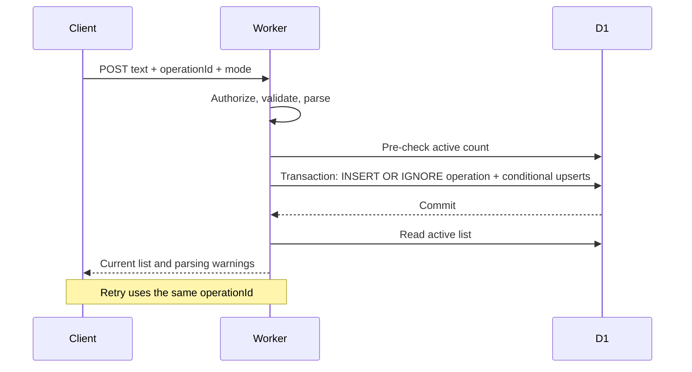

# Architecture notes

## Scope and runtime

Agala has one household list, one Worker, and one D1 database. Static assets are embedded as strings in the Worker bundle. There is no separate frontend server or Node.js production process. The browser uses same-origin JSON requests and renders user-controlled text with `textContent`.

The backend exposes a small SQL-oriented `Database` interface. Production D1 satisfies that interface; tests implement it with Node's in-memory SQLite. This keeps the behavioral tests close to the actual SQL without introducing a repository layer solely for testing.

## Data model

| Table         | Purpose                                                                                          |
| ------------- | ------------------------------------------------------------------------------------------------ |
| `items`       | Product identity, quantity, unit, department, checked/archived flags, revision, update timestamp |
| `operations`  | Applied addition IDs and transaction markers                                                     |
| `ai_requests` | Per-user operation hash, processing state/lease, validated analysis result                       |
| `ai_usage`    | Shared provider-attempt count keyed by UTC calendar month                                        |

The product key is `normalize(name) + '|' + unit`. Normalization handles Hebrew marks, quotation marks, and whitespace. It intentionally preserves percentages and other product qualifiers. The database enforces unique product keys, positive bounded quantities, and valid boolean flags. Allowed units and departments are checked in application code.

Deletion and purchased cleanup set `archived=1`. The row remains available for undo or later reopening. Re-adding a checked or archived product reopens it at the requested quantity; adding an explicit quantity to an active unchecked product increments it, capped at 10,000. Bare duplicate additions retain the existing quantity. A different unit creates a separate product rather than performing an implicit conversion.

## Addition transaction

Each server attempt generates a fresh marker. The transaction inserts the user-scoped operation ID only if it does not exist. Each product upsert is guarded by the presence of that operation ID with this attempt's marker. If a previous attempt committed, the retry's marker does not match and its upserts do nothing.

The resulting list is read after the transaction, so it may include another client's subsequently committed change. There is no versioned list snapshot or event stream. Operation IDs prevent repeated writes, but the basic-parser path does not bind an operation ID to a text hash. Clients must keep the same text for a retried operation. The active-count check happens before the transaction and conservatively counts incoming parsed items, including duplicates. It can reject a duplicate near capacity and does not strictly enforce the cap under concurrent requests.

## Revisions, cleanup, and undo

Individual mutations use `WHERE id=? AND revision=? AND archived=0` and increment the revision. If no row matches, the server returns 409; the client refreshes and lets the user retry. This is optimistic concurrency control, not automatic merging.

Cleanup takes the checked-item snapshot visible when the confirmation dialog opens. Each row is archived only if it is still checked and still has the expected revision. Undo receives the IDs and post-removal revisions returned by the server. It restores only rows that remain archived at those revisions. A product re-added from the other phone is not overwritten by a stale undo.

Bulk changes use chunks of 49 items. Each query binds two parameters per item plus a timestamp, and one request uses at most 11 such queries for a 500-item snapshot. This stays within the conservative D1 budgets enforced by the test adapter (100 parameters/query and 50 statements/batch). The 18-second undo interval belongs to the UI; the server has no time-based expiry for restoration of a still-matching revision.

## Browser behavior

`web/client.ts` holds the list, filter/search state, mutation state, and dialog snapshots in memory. It rebuilds the list DOM after changes. Polling compares the received list with the current one and avoids re-rendering when it is unchanged. Local writes are serialized by a busy flag. The UI waits for successful persistence before clearing the input or marking the message as saved.

A pending addition retains its operation ID while retrying the same text and parser mode in that page session. Reloading the page loses that pending state; there is no durable outbox. Refreshes pause while the document is hidden, while a local mutation is active, and while the authentication dialog is open.

The floating composer uses `visualViewport` height/offset and a `ResizeObserver` for composer height. Repeated layout writes are avoided through cached measurements and animation-frame batching. Confirmations use `pointer-events: none` except for the dismiss button, allowing the list underneath to receive wheel and touch gestures. This is a device-driven correction, not evidence of an exhaustive browser compatibility test.

The HTML uses RTL direction, named controls, native dialogs, live status regions, and visible focus styles. There has been no formal accessibility audit.

## API surface

All `/api/` routes require authorization. Mutation requests require JSON and reject an explicitly foreign Origin. Error messages are in Hebrew.

| Method and route        | Behavior                                                 |
| ----------------------- | -------------------------------------------------------- |
| `GET /api/items`        | Active list plus authentication mode and AI availability |
| `GET /api/access`       | Partner access link; owner-only and link mode only       |
| `POST /api/items`       | Parse and apply additions with an operation ID           |
| `PATCH /api/items/:id`  | Check/uncheck or edit a product with a revision          |
| `DELETE /api/items/:id` | Archive one product with a revision                      |
| `POST /api/clear`       | Archive still-matching checked products from a snapshot  |
| `POST /api/restore`     | Restore still-matching archived products                 |

`handle()` in `src/worker.ts` owns routing and validation. The Worker does not accept arbitrary SQL or field names from the client. JSON bodies are read and then bounded to 16,000 characters; this is not a streaming byte limit.

## Optional AI path

AI is a parser option, not an autonomous agent. The application controls writes. The Responses API request contains fixed extraction instructions and only the submitted message. It requests strict JSON Schema output with no tools, a 4,000-token output allowance, a 12-second timeout, and `store: false`. The current list, chat history, and account identifiers are not included in the provider prompt. Provider retention rules still apply despite `store: false`.

The server checks allowed departments/units, finite positive quantities, product/name limits, and output kind before constructing SQL. Ambiguous and unsupported requests return a clarification without applying additions. Provider errors do not trigger an automatic switch to deterministic parsing.

`ai_requests` scopes a request by user and operation ID and associates it with a SHA-256 hash of the text. A successful analysis is reused; changed text with that ID is rejected. A processing lease prevents immediate concurrent duplicate analysis, and failed requests have a short retry delay. Before a provider attempt, an atomic SQL upsert reserves one shared monthly allowance slot. Failed provider attempts also count. An allowance of zero stops new AI calls; cached successful results can still be reused.

This reduces duplicate provider calls; it does not provide exactly-once billing across the remote API and local database. If the provider completes but the result cannot be cached, a later retry can call the provider again. The allowance counts attempts, not dollars. Cached analysis results include extracted product names even though the original message is stored only as a hash. These records currently have no retention cleanup.

Tests mock the provider and cover output failures and application behavior. They do not measure semantic Hebrew accuracy. A live evaluation set, supported model selection, and provider budget settings are deployment follow-ups.

## Boundaries worth preserving

The household use case does not currently justify React, a general agent framework, WebSockets, microservices, or multi-tenant tables. Improvements should follow observed behavior: add browser regression coverage, define record retention, or make capacity enforcement transactional before expanding the feature set. Keep schema changes in new migrations and verify conflict/retry behavior whenever changing mutation paths.
